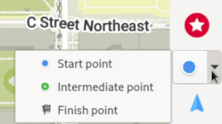
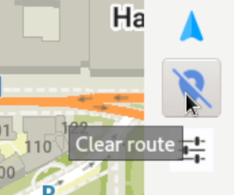
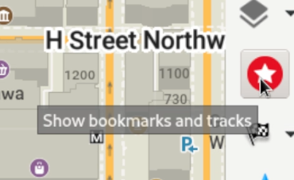

Linux에서 Flatpak으로 Organic Maps를 설치하려면 터미널에서 `flatpak install flathub app.organicmaps.desktop`을 실행하세요.

앱을 설치한 뒤 마우스 휠이나 오른쪽 메뉴 막대의 버튼으로 이동할 지역을 확대하면 해당 지도를 다운로드할 수 있습니다. 오른쪽 아래의 다운로드 아이콘을 눌러도 됩니다. 필요한 지역의 지도를 받은 다음에는 인터넷 연결 없이 앱을 사용할 수 있습니다.

아이콘 위에 마우스 포인터를 올리면 간단한 설명이 표시됩니다.

경로를 만들고 길 안내를 받는 방법은 여러 가지입니다. 출발지와 목적지의 GPS 좌표를 안다면 녹색 체크 표시 위의 설정 아이콘을 눌러 좌표를 입력하세요. 지도에서 직접 출발지를 지정하려면 길 안내 아이콘을 누르고 ‘출발지’를 선택한 다음 Shift 키를 누른 채 지도에서 마우스 왼쪽 버튼을 클릭하세요. 목적지는 ‘목적지’로 바꾼 뒤 지도의 해당 위치를 클릭해 지정하세요.

길 안내를 지우려면 설정 아이콘 바로 위의 파란색 아이콘을 누르세요.

주소나 목적지를 검색하려면 돋보기 아이콘을 누르고 주소나 검색어를 입력하세요.

장소를 북마크에 추가하려면 Alt 키를 누른 채 해당 장소를 마우스 오른쪽 버튼으로 클릭하세요. 북마크가 바로 보이지 않을 수 있습니다. 북마크를 확인하거나 관리하려면 빨간색 별 아이콘을 누르세요.

Linux 데스크톱 앱은 주로 개발에 사용됩니다. 모바일용으로 빌드하지 않고도 자동 테스트를 실행하거나 로직을 확인할 수 있습니다. Linux 버전을 더 편리하게 만드는 데 함께할 분을 환영합니다!
