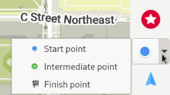
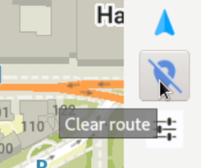
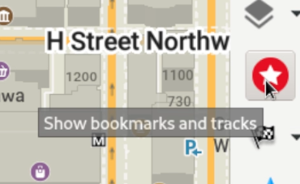

Чтобы установить Organic Maps в Linux через Flatpak, откройте терминал и введите `flatpak install flathub app.organicmaps.desktop`.

После установки приложения приблизьте нужную область колёсиком мыши или кнопками на правой панели, чтобы загрузить её карту. Можно также нажать иконку загрузки справа внизу. После загрузки карт нужных регионов приложение должно работать без интернета.

Наведите указатель на иконку, чтобы увидеть подсказку.

Для прокладки маршрута и пошаговой навигации есть несколько вариантов. Если вы знаете GPS-координаты начальной и конечной точек, нажмите иконку настроек над зелёной галочкой и введите координаты. Чтобы задать начальную точку на карте, нажмите иконку навигации, выберите «Начальная точка», затем удерживайте Shift и щёлкните по карте левой кнопкой мыши. Для назначения выберите «Конечная точка» и нажмите нужное место на карте.

Нажмите синюю иконку прямо над настройками, чтобы очистить навигацию.

Для поиска адресов и мест нажмите лупу и введите адрес или поисковый запрос.

Чтобы сохранить место в метки, удерживайте Alt и щёлкните по нему правой кнопкой мыши. Метка может быть видна не сразу; для просмотра и управления метками нажмите иконку красной звезды.

Настольная версия для Linux в основном используется для разработки: автоматических тестов и проверки логики без сборки для мобильных устройств. Мы рады волонтёрам, которые помогут улучшить удобство версии для Linux!
