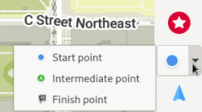
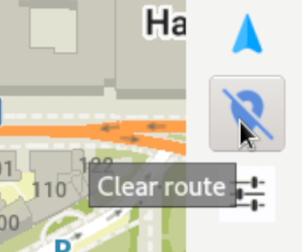
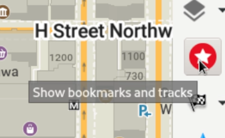

Щоб установити Organic Maps у Linux через Flatpak, відкрийте термінал і введіть `flatpak install flathub app.organicmaps.desktop`.

Після встановлення застосунку наблизьте потрібну область коліщатком миші або кнопками на правій панелі, щоб завантажити її мапу. Можна також натиснути іконку завантаження справа внизу. Після завантаження мап потрібних регіонів застосунок має працювати без інтернету.

Наведіть вказівник на іконку, щоб побачити підказку.

Для прокладання маршруту й покрокової навігації є кілька варіантів. Якщо ви знаєте GPS-координати початкової та кінцевої точок, натисніть іконку налаштувань над зеленою позначкою й введіть координати. Щоб задати початкову точку на мапі, натисніть іконку навігації, виберіть «Початкова точка», потім утримуйте Shift і клацніть на мапі лівою кнопкою миші. Для призначення виберіть «Кінцева точка» й натисніть потрібне місце на мапі.

Натисніть синю іконку просто над налаштуваннями, щоб очистити навігацію.

Для пошуку адрес і місць натисніть лупу й введіть адресу або пошуковий запит.

Щоб зберегти місце в мітки, утримуйте Alt і клацніть на ньому правою кнопкою миші. Мітку може бути видно не відразу; для перегляду й керування мітками натисніть іконку червоної зірки.

Настільна версія для Linux переважно використовується для розробки: автоматичних тестів і перевірки логіки без збирання для мобільних пристроїв. Ми раді волонтерам, які допоможуть поліпшити зручність версії для Linux!
