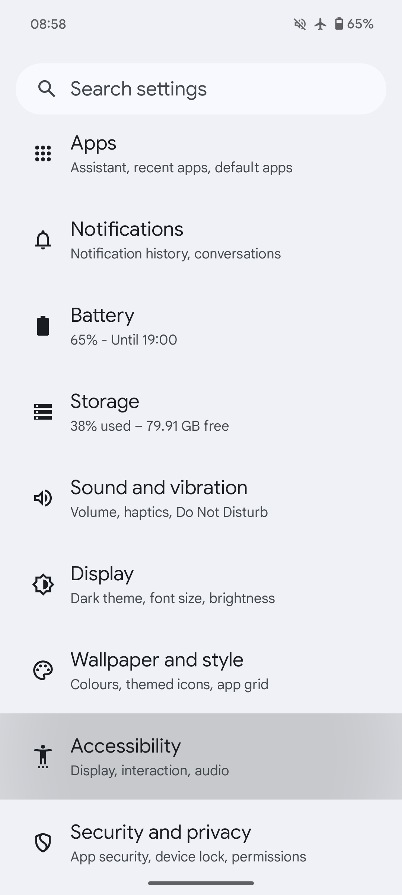
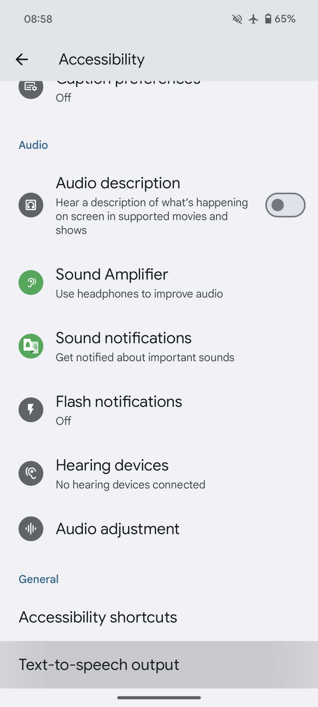
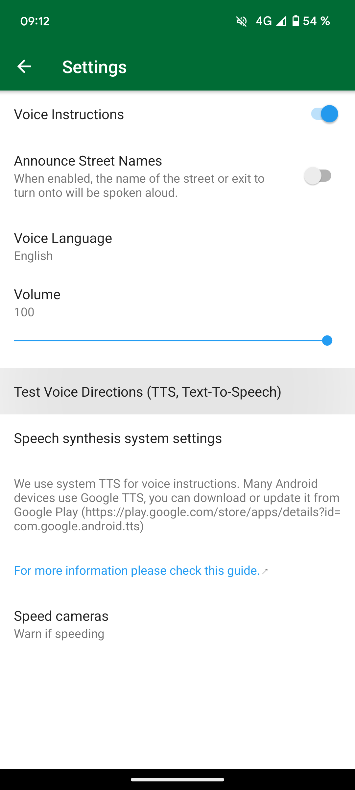

## 요약

Organic Maps는 음성 안내에 시스템의 텍스트 음성 변환(TTS) 엔진을 사용합니다. 기본 엔진은 기기마다 다릅니다. Google 텍스트 음성 변환, 기기 제조사의 엔진 또는 서드파티 엔진을 사용할 수 있습니다.

Organic Maps에서 공식적으로 권장하는 엔진은 무료 오픈소스 음성 엔진 [RHVoice](https://rhvoice.org/)입니다. [Google Play](https://play.google.com/store/apps/details?id=com.github.olga_yakovleva.rhvoice.android) 또는 [F-Droid](https://f-droid.org/en/packages/com.github.olga_yakovleva.rhvoice.android/)에서 다운로드할 수 있습니다.

## 설정 방법

- Android 기기의 설정 앱을 여세요.
- ‘추가 설정’으로 이동한 후 ‘접근성’을 선택하세요.
- 원하는 엔진, 말하기 속도, 음높이를 선택하세요.
- **Organic Maps 앱을 다시 시작하세요.**
- Organic Maps의 ‘설정 → 음성 지침’에서 음성 안내를 설정하세요.
- 음성이 나오지 않으면 Organic Maps 앱을 다시 시작하거나 기기를 재부팅하세요.

해당 설정을 찾을 수 없다면 설정 앱에서 ‘텍스트 음성 변환’을 검색하세요.

메뉴와 설정 단계는 기기 제조사에 따라 다를 수 있습니다.

기기에 TTS 엔진이 설치되어 있지 않으면 위 설정이 표시되지 않을 수 있습니다. 아래 표에서 사용할 언어를 지원하는 엔진을 찾아 설치하세요.

## 설정 화면

|             |             |
| ----------- | ----------- |
 | 

## TTS 엔진 {#engines}

아래 표에서 엔진별 지원 언어를 확인하세요. 다운로드 링크는 표 아래에 있습니다.

{{ <tts_table lang /> }}

## 문제가 발생할 때

LineageOS 등 맞춤 ROM에서 RHVoice TTS 엔진을 시작하는 데 문제가 있다면 다음 방법을 시도해 보세요. 특히 기기를 처음 설정했거나 초기화한 뒤 TTS 엔진을 한 번도 사용하지 않았다면 RHVoice가 제대로 시작되지 않아 앱이 비정상 종료될 수 있습니다. LineageOS와 같은 맞춤 ROM에서 <ins>Google Play 서비스와 Google 음성 서비스가 설치되어 있지 않은 상태</ins>로 RHVoice를 사용하려면 다음 단계를 따르세요.

1. F-Droid에서 [eSpeak TTS 엔진](https://f-droid.org/en/packages/com.reecedunn.espeak)을 설치하세요.
2. 시스템의 기본 엔진으로 지정하세요.
    - LineageOS의 **설정**을 여세요.
    - 아래로 스크롤해 **접근성**을 찾으세요.
    - **텍스트 음성 변환 출력**에서 왼쪽의 **기본 엔진**을 선택하고 **eSpeak**가 지정되어 있는지 확인하세요.
3. 이전 화면으로 돌아가 **재생**을 눌러 소리가 나는지 확인하세요.
4. F-Droid에서 [RHVoice](https://f-droid.org/en/packages/com.github.olga_yakovleva.rhvoice.android/)를 설치하세요.
    - 앱을 열고 사용할 언어를 선택한 뒤, 맨 왼쪽의 구름 아이콘을 눌러 음성을 다운로드하세요.
    - 재생 버튼을 눌러 음성이 나오는지 확인하세요.
5. 2단계를 따라 **RHVoice**를 기본 엔진으로 설정하세요.
6. 이제 RHVoice를 사용할 수 있습니다.

## 음성 안내 테스트

Organic Maps의 ‘설정 → 음성 지침’에서 ‘음성 길 안내 테스트(TTS, 텍스트 음성 변환)’를 누르거나, 실제로 길 안내를 시작해 안내 음성을 확인하세요. 제자리에 서 있을 때는 음성 안내가 나오지 않습니다.

