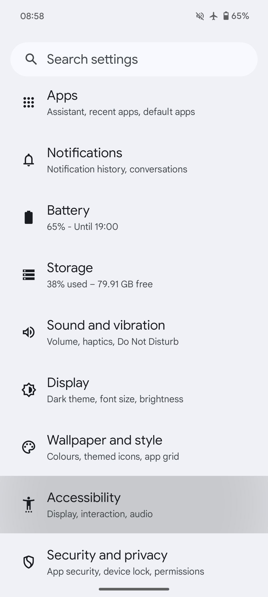
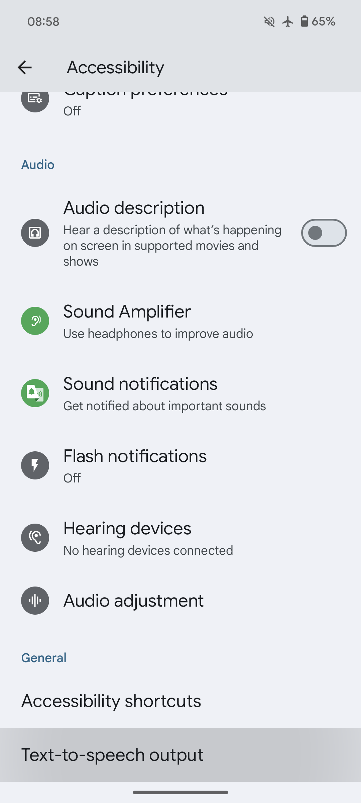
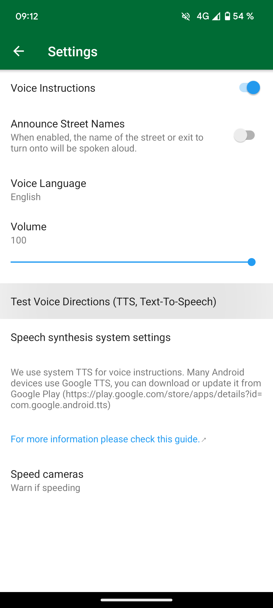

Open Android settings and search for **Text-to-speech**. Choose an installed engine, download a voice for your language, and use its sample playback to check it. Then select a matching voice language in Organic Maps and use the app's voice test. Restart Organic Maps after changing the system engine if the new voice does not work.

Example Android settings screens

These screenshots show one device's **Accessibility → Text-to-speech output** settings. Menu names and locations vary by Android version and manufacturer; searching settings for **Text-to-speech** is usually the easiest way to find them.

| Android settings | Accessibility settings |
| --- | --- |
|  |  |

## Engines {#engines}

Engines and offline language packs differ by device. Google Speech Services, a manufacturer's engine, or an open-source engine such as [RHVoice](https://rhvoice.org/) may be suitable. RHVoice is available from [Google Play](https://play.google.com/store/apps/details?id=com.github.olga_yakovleva.rhvoice.android) and [F-Droid](https://f-droid.org/en/packages/com.github.olga_yakovleva.rhvoice.android/). [Open RHVoice and download a voice](https://rhvoice.org/installation/) before selecting it as the system engine. Speech rate and pitch are usually controlled in the system or engine settings.

Use the comparison below to find engines for your language, then check the engine's current voice catalogue and offline support before installing. The table is a reference, not a guarantee for every device or installed version; some entries describe support being prepared for a future release.

Compare speech engines by language

{{ <tts_table lang /> }}

## Test the voice offline

Test with the network disconnected before travelling. In Organic Maps, open **Settings → Voice Instructions** and use **Test Voice Directions**. If the test is silent, check the system engine's sample playback, downloaded voice, media volume and Bluetooth output. See [voice-guidance troubleshooting](@/faq/voice/cant-hear-instructions/index.md) if speech still fails or stops with the screen off.

Example Organic Maps voice-test screen

The screenshot shows the voice-test control; its appearance may differ in your app version.

## What if Text-to-speech settings crash on LineageOS?

Some LineageOS versions have a [reported Settings crash when only one TTS engine is installed](https://gitlab.com/LineageOS/issues/android/-/issues/3678). If opening **Text-to-speech output** crashes Settings while RHVoice is installed, try this workaround:

1. Install a second engine, such as [eSpeak](https://f-droid.org/en/packages/com.reecedunn.espeak/), alongside RHVoice.
2. Reopen **Text-to-speech output**, select eSpeak as the preferred engine, and test its sample playback.
3. Open RHVoice, download and test a voice for your language, then select RHVoice as the preferred system engine.
4. Test speech in Android settings and Organic Maps again.

This workaround has helped affected devices but does not fix every TTS problem. If Settings still crashes, include your device and LineageOS version when reporting the problem to LineageOS. If system speech works but Organic Maps is silent, follow the [voice-guidance checks](@/faq/voice/cant-hear-instructions/index.md).
