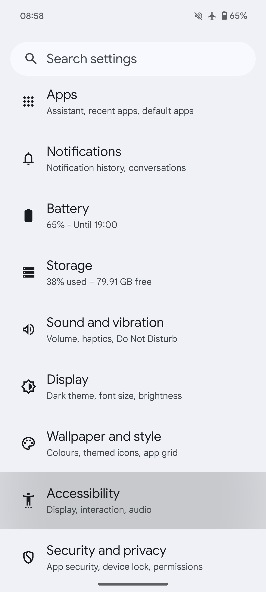
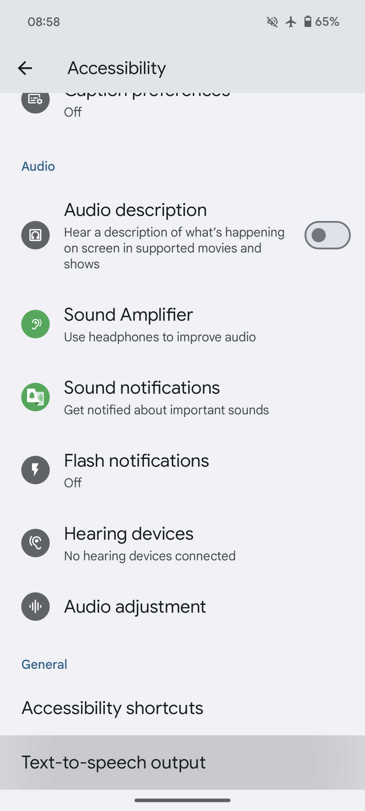
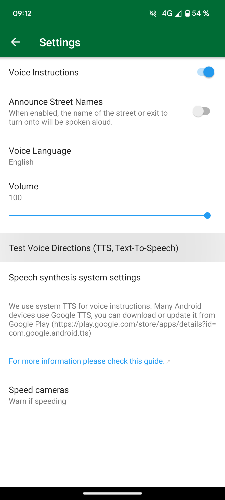

Откройте настройки Android и найдите **Синтез речи**. Выберите установленный движок, загрузите голос для своего языка и проверьте его с помощью воспроизведения примера. Затем выберите соответствующий язык голоса в Organic Maps и выполните проверку голоса в приложении. Перезапустите Organic Maps после смены системного движка, если новый голос не работает.

Примеры экранов настроек Android

На этих скриншотах показаны настройки **Специальные возможности → Синтез речи** одного устройства. Названия и расположение пунктов зависят от версии Android и производителя; обычно проще всего найти в настройках **Синтез речи**.

| Настройки Android | Специальные возможности |
| --- | --- |
|  |  |

## Движки {#engines}

Движки и офлайн-языковые пакеты зависят от устройства. Могут подойти речевые сервисы Google, движок производителя или открытый движок, например [RHVoice](https://rhvoice.org/). RHVoice доступен в [Google Play](https://play.google.com/store/apps/details?id=com.github.olga_yakovleva.rhvoice.android) и [F-Droid](https://f-droid.org/en/packages/com.github.olga_yakovleva.rhvoice.android/). [Откройте RHVoice и загрузите голос](https://rhvoice.org/installation/), прежде чем выбирать его системным движком. Скорость речи и высота тона обычно задаются в настройках системы или движка.

В сравнении ниже можно найти движки для своего языка, затем перед установкой проверьте актуальный каталог голосов и поддержку работы без интернета у выбранного движка. Таблица служит справочником, но не гарантирует работу на каждом устройстве или в любой установленной версии; некоторые записи описывают поддержку, которая готовится к будущему выпуску.

Сравнение речевых движков по языкам

{{ <tts_table lang /> }}

## Проверка голоса без интернета {#testing}

Перед поездкой проверьте работу с отключённой сетью. В Organic Maps откройте **Настройки → Голосовые инструкции** и нажмите **Протестировать голосовые подсказки (TTS, Text-To-Speech)**. Если звука нет, проверьте пример речи системного движка, загруженный голос, громкость мультимедиа и вывод через Bluetooth. Если речь по-прежнему не работает или прекращается с выключенным экраном, прочитайте [советы по голосовым подсказкам](@/faq/voice/cant-hear-instructions/index.ru.md).

Пример экрана проверки голоса в Organic Maps

На скриншоте показана кнопка проверки голоса; в вашей версии приложения её вид может отличаться.

## Что делать, если настройки синтеза речи вылетают на LineageOS? {#workarounds}

Для некоторых версий LineageOS есть [сообщение о сбое настроек, когда установлен только один движок TTS](https://gitlab.com/LineageOS/issues/android/-/issues/3678). Если открытие **Синтез речи** вызывает сбой настроек при установленном RHVoice, попробуйте этот обходной способ:

1. Установите второй движок, например [eSpeak](https://f-droid.org/en/packages/com.reecedunn.espeak/), вместе с RHVoice.
2. Снова откройте **Синтез речи**, выберите eSpeak предпочтительным движком и проверьте пример речи.
3. Откройте RHVoice, загрузите и проверьте голос для своего языка, затем выберите RHVoice предпочтительным системным движком.
4. Ещё раз проверьте речь в настройках Android и Organic Maps.

Этот способ помогал на затронутых устройствах, но не исправляет любую проблему TTS. Если настройки всё ещё вылетают, при сообщении о проблеме в LineageOS укажите устройство и версию системы. Если системная речь работает, а Organic Maps молчит, выполните [проверки голосовых подсказок](@/faq/voice/cant-hear-instructions/index.ru.md).
