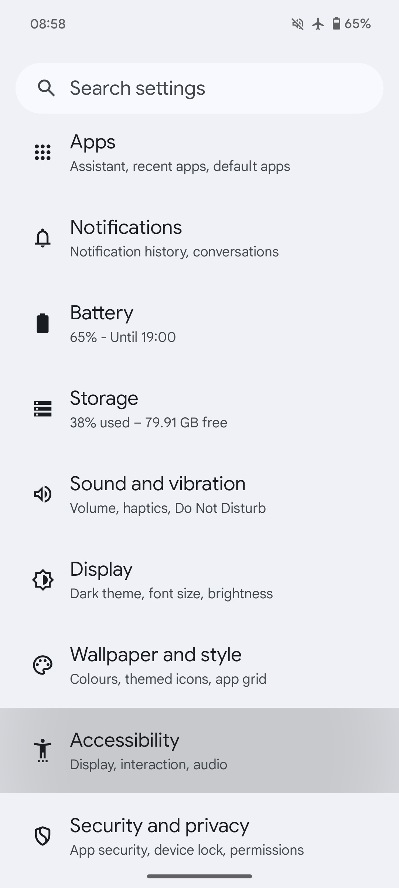
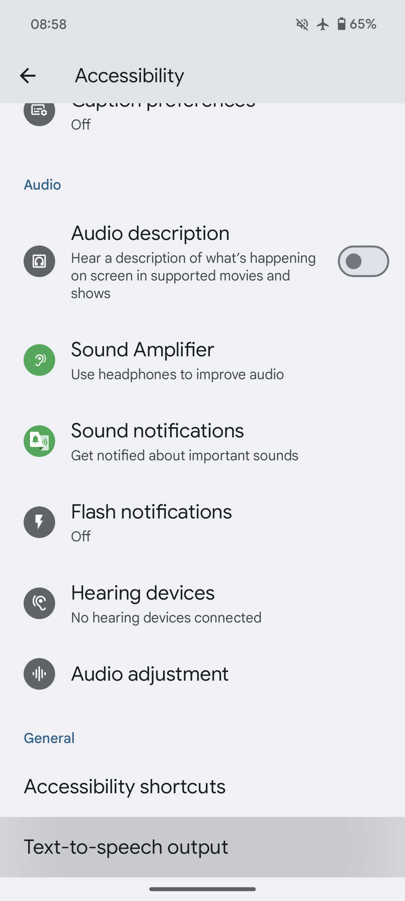
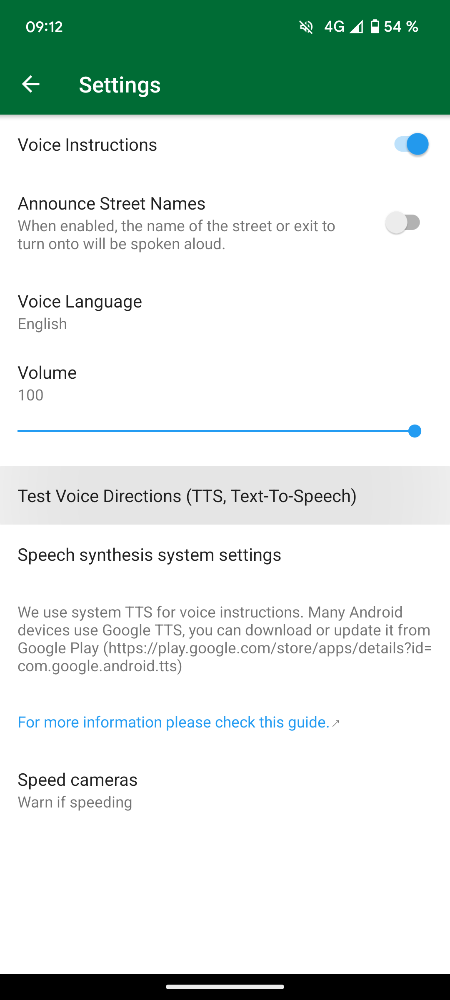

Відкрийте налаштування Android і знайдіть **Синтез мовлення**. Виберіть установлений рушій, завантажте голос для своєї мови й перевірте його за допомогою відтворення прикладу. Потім виберіть відповідну мову голосу в Organic Maps і виконайте перевірку голосу в застосунку. Перезапустіть Organic Maps після зміни системного рушія, якщо новий голос не працює.

Приклади екранів налаштувань Android

На цих скріншотах показані налаштування **Спеціальні можливості → Синтез мовлення** одного пристрою. Назви й розташування пунктів залежать від версії Android та виробника; зазвичай найпростіше знайти в налаштуваннях **Синтез мовлення**.

| Налаштування Android | Спеціальні можливості |
| --- | --- |
|  |  |

## Рушії {#engines}

Рушії та офлайн-мовні пакети залежать від пристрою. Можуть підійти мовленнєві сервіси Google, рушій виробника або відкритий рушій, наприклад [RHVoice](https://rhvoice.org/). RHVoice доступний у [Google Play](https://play.google.com/store/apps/details?id=com.github.olga_yakovleva.rhvoice.android) та [F-Droid](https://f-droid.org/en/packages/com.github.olga_yakovleva.rhvoice.android/). [Відкрийте RHVoice й завантажте голос](https://rhvoice.org/installation/), перш ніж вибирати його системним рушієм. Швидкість мовлення та висота тону зазвичай задаються в налаштуваннях системи чи рушія.

У порівнянні нижче можна знайти рушії для своєї мови, потім перед установленням перевірте актуальний каталог голосів і підтримку роботи без інтернету у вибраного рушія. Таблиця слугує довідником, але не гарантує роботи на кожному пристрої чи в будь-якій установленій версії; деякі записи описують підтримку, яка готується до майбутнього випуску.

Порівняння мовленнєвих рушіїв за мовами

{{ <tts_table lang /> }}

## Перевірка голосу без інтернету {#testing}

Перед поїздкою перевірте роботу з вимкненою мережею. В Organic Maps відкрийте **Налаштування → Голосові інструкції** й натисніть **Тестування голосових підказок (TTS, Text-To-Speech)**. Якщо звуку немає, перевірте приклад мовлення системного рушія, завантажений голос, гучність мультимедіа та виведення через Bluetooth. Якщо мовлення все ще не працює або припиняється за вимкненого екрана, прочитайте [поради щодо голосових підказок](@/faq/voice/cant-hear-instructions/index.uk.md).

Приклад екрана перевірки голосу в Organic Maps

На скріншоті показана кнопка перевірки голосу; у вашій версії застосунку її вигляд може відрізнятися.

## Що робити, якщо налаштування синтезу мовлення аварійно завершуються на LineageOS? {#workarounds}

Для деяких версій LineageOS є [повідомлення про збій налаштувань, коли встановлено лише один рушій TTS](https://gitlab.com/LineageOS/issues/android/-/issues/3678). Якщо відкриття **Синтез мовлення** спричиняє збій налаштувань за встановленого RHVoice, спробуйте цей обхідний спосіб:

1. Установіть другий рушій, наприклад [eSpeak](https://f-droid.org/en/packages/com.reecedunn.espeak/), разом із RHVoice.
2. Знову відкрийте **Синтез мовлення**, виберіть eSpeak бажаним рушієм і перевірте приклад мовлення.
3. Відкрийте RHVoice, завантажте й перевірте голос для своєї мови, потім виберіть RHVoice бажаним системним рушієм.
4. Ще раз перевірте мовлення в налаштуваннях Android та Organic Maps.

Цей спосіб допомагав на відповідних пристроях, але не виправляє будь-якої проблеми TTS. Якщо налаштування все ще аварійно завершуються, повідомляючи про проблему в LineageOS, укажіть пристрій і версію системи. Якщо системне мовлення працює, а Organic Maps мовчить, виконайте [перевірки голосових підказок](@/faq/voice/cant-hear-instructions/index.uk.md).
